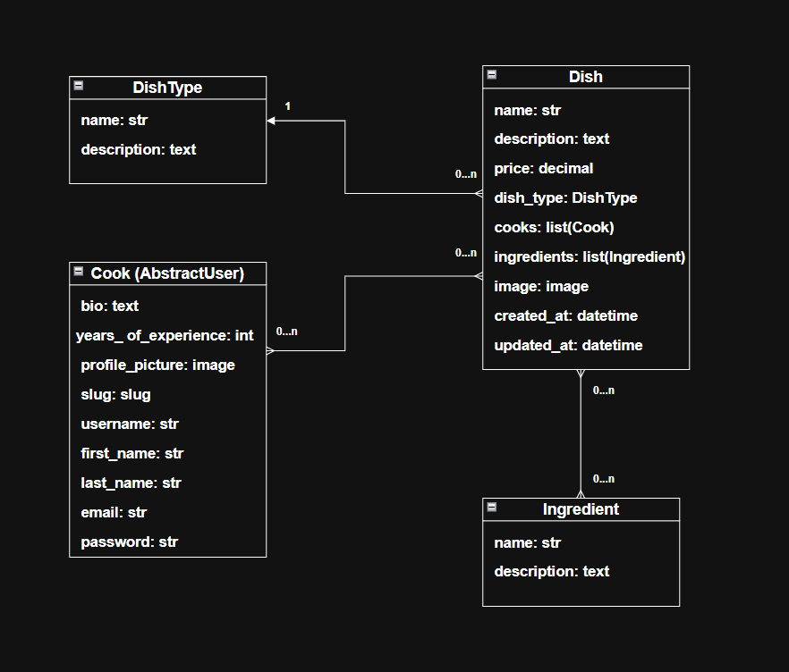

# Restaurant Kitchen Management (Django)
A full‑featured Django web application for managing a restaurant kitchen: cooks, dishes, ingredients, and dish types — all wrapped in a clean UI with authentication, search, CRUD operations, and image uploads.

This project demonstrates solid Django architecture, class‑based views, custom user models, form handling, media management, and admin customization.

## 🚀 Live Demo
🔗 Render Deployment:  
[Restaurant Mate project is deployed to Render](https://restaurant-kitchen-mate-hcgj.onrender.com/)

Test User Credentials
```
login: user  
password: user12345
```

## 📌 Features
### 👨‍🍳 User(Cook) & Authentication
- Custom Cook model extending AbstractUser
- Automatic unique slug generation for profile URLs
- Profile pictures upload with validation
- Login, logout, and registration
- Permissions integrated with Django Admin

### 🍲 Dish Management
- Create, update, delete dishes
- Assign cooks to dishes (toggle assign)
- Add ingredients and dish types
- Image upload for dishes
- Price validation with DecimalValidator

### 🧂 Ingredients & Dish Types
- Full CRUD for ingredients and dish types
- Search functionality for all list views

### 🖥️ UI & UX
- Pagination across all list views
- Search forms for cooks, dishes, dish types, ingredients
- Recently updated dishes on the homepage
- Previous URL middleware for improved navigation

### 🛠️ Admin Panel
- Custom admin for Cook, Dish, DishType, Ingredient
- Read‑only slug field
- Extended fieldsets for additional cook info

### ⚙️ Developer‑Friendly Architecture
- Class‑based views everywhere
- Reusable forms and mixins
- Clean URL structure with namespaces
- Debug Toolbar integration
- Media file support

## Project Structure (Simplified)
```
restaurant_mate/
│
├── kitchen/
│   ├── models.py          # Cook, Dish, Ingredient, DishType
│   ├── views.py           # All CBVs + toggle assign
│   ├── forms.py           # Creation/update/search forms
│   ├── urls.py            # App routes
│   ├── admin.py           # Admin customization
│   ├── templatetags/      # query_transform tag
│   └── templates/         # HTML templates
│
├── restaurant_mate/
│   ├── settings.py
│   ├── urls.py            # Project routes
│   └── middleware.py      # StorePreviousURLMiddleware
│
├── media/                 # Uploaded images
├── static/                # Static files
└── README.md
```

## Tech Stack
| Component            | Version    |
| -------------------- | ---------- |
| Python               | 3.12.2     |
| Django               | 5.0.7      |
| Pillow               | 10.4.0     |
| Django Debug Toolbar | Enabled    |
| Render               | Deployment |

## Installation & Setup
Make sure Python 3.12+ is installed.

### Installation
Python 3 must be preinstalled.

  ```bash
git clone https://github.com/dkibalenko/restaurant-mate
cd restaurant-mate

python3 -m venv env
source env/bin/activate

pip install -r requirements.txt

python manage.py migrate
python manage.py createsuperuser
python manage.py runserver

  ```
Visit the app at:
👉 http://localhost:8000/

## Media Files
This project uses ImageField for:
- Cook profile pictures
- Dish images

## Searching
Each list view includes a search bar:
- Cooks → search by username
- Dishes → search by name
- Dish Types → search by name
- Ingredients → search by name
- Search queries persist thanks to the custom query_transform template tag.

## Notable Code Highlights
✔️ Unique Slug Generation for Cooks
Automatically regenerates slug when first/last name changes.

✔️ Toggle Assign Cook to Dish
Simple POST‑based toggle without extra forms.

✔️ Previous URL Middleware
Stores HTTP_REFERER for improved navigation.

✔️ Prefetch Optimization
Dish list and index views use prefetch_related("ingredients").

## Contributing
1. Fork the repository

2. Create a feature branch
```bash
git checkout -b feature/my-feature
```
3. Commit your changes
```bash
git commit -am "Add my feature"
```
4. Push the branch
```bash
git push origin feature/my-feature
```
5. Open a Pull Request

## **Database Schema**

